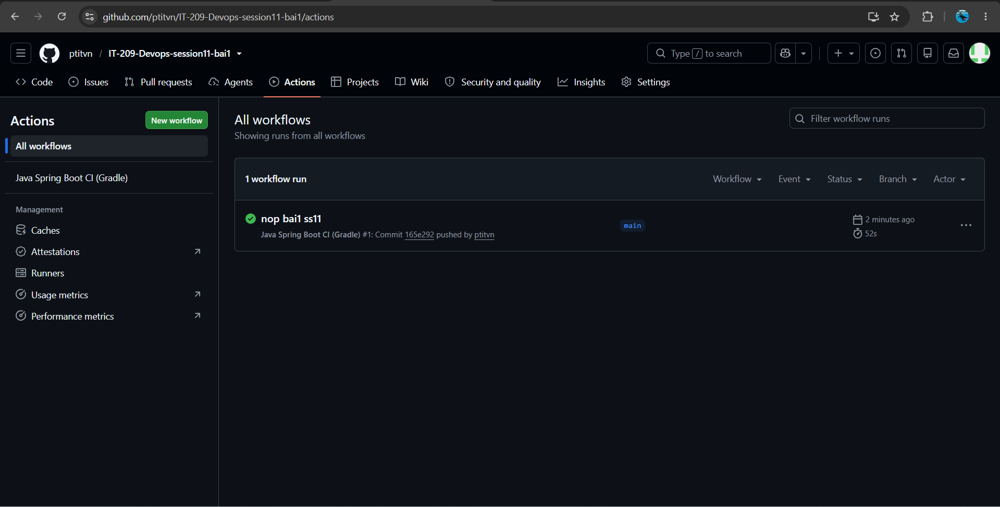
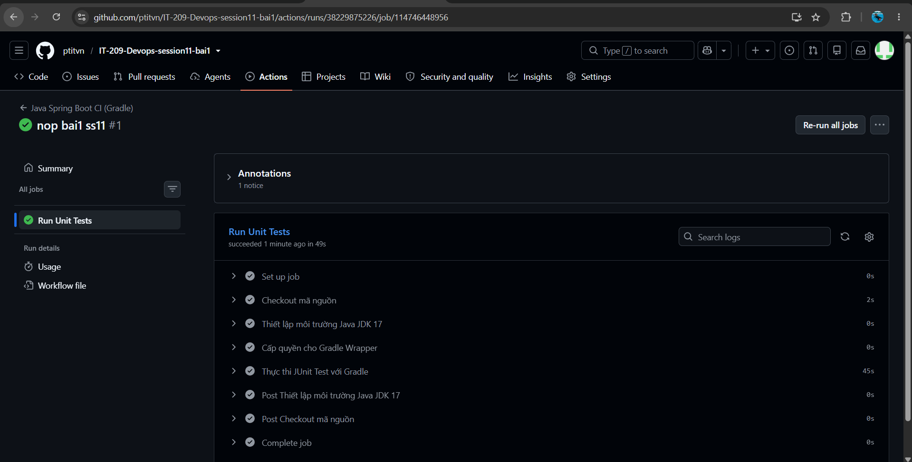

# Bài 1: Khởi tạo Workflow chạy Unit Test tự động cho Java Spring Boot với Gradle

## 1. Mục tiêu
- Khởi tạo tệp kịch bản GitHub Actions Workflow cho dự án Java Spring Boot sử dụng Gradle.
- Cấu hình môi trường Java JDK 17 (Temurin) và tự động chạy bài kiểm thử JUnit Test bằng Gradle Wrapper (`./gradlew test`).

## 2. Cấu trúc thư mục nộp bài
```text
bai1/
├── .github/
│   └── workflows/
│       └── ci.yml
├── gradle/
│   └── wrapper/
│       ├── gradle-wrapper.jar
│       └── gradle-wrapper.properties
├── homework/
│   └── session_11/
│       └── ex1/
│           ├── ci.yml
│           ├── github-actions-overview.png
│           ├── unit-test-job-detail.png
│           └── README.md
├── src/
│   ├── main/
│   │   ├── java/com/example/demo/
│   │   │   ├── DemoApplication.java
│   │   │   └── controller/HelloController.java
│   │   └── resources/application.properties
│   └── test/
│       └── java/com/example/demo/
│           ├── DemoApplicationTests.java
│           └── HelloControllerTest.java
├── .gitignore
├── build.gradle
├── gradlew
├── gradlew.bat
├── README.md
└── settings.gradle
```

## 3. Nội dung Workflow CI (`.github/workflows/ci.yml`)
```yaml
name: Java Spring Boot CI (Gradle)

on:
  push:
    branches: [ "main" ]

jobs:
  test:
    name: Run Unit Tests
    runs-on: ubuntu-latest

    steps:
      - name: Checkout mã nguồn
        uses: actions/checkout@v5

      - name: Thiết lập môi trường Java JDK 17
        uses: actions/setup-java@v5
        with:
          java-version: '17'
          distribution: 'temurin'

      - name: Cấp quyền cho Gradle Wrapper
        run: chmod +x gradlew

      - name: Thực thi JUnit Test với Gradle
        run: ./gradlew test
```

## 4. Kết quả thực thi trên GitHub Actions

### 4.1. Tổng quan Workflow Run (Tích xanh thành công)


### 4.2. Chi tiết Job "Run Unit Tests"


- **Trạng thái:** Success (Tích xanh)
- **Thời gian chạy:** 52s
- **Các bước:**
  - `Checkout mã nguồn` (actions/checkout@v5) - Thành công
  - `Thiết lập môi trường Java JDK 17` (actions/setup-java@v5) - Thành công
  - `Cấp quyền cho Gradle Wrapper` (`chmod +x gradlew`) - Thành công
  - `Thực thi JUnit Test với Gradle` (`./gradlew test`) - Thành công
